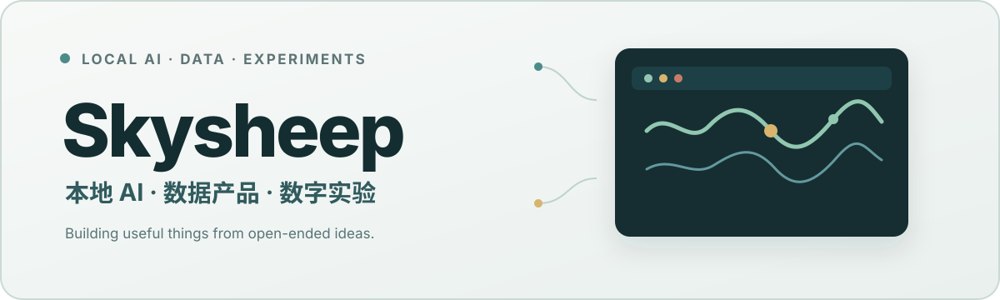

<a href="./README.md">简体中文</a>&nbsp;&nbsp;·&nbsp;&nbsp;English

<picture>
  
</picture>

<picture>
  <source media="(prefers-color-scheme: dark)" srcset="./assets/typing-dark.svg">
  
</picture>

## English

Hi, I'm **Skysheep**, a student at **Renmin University of China**, based in Beijing.

I enjoy turning open-ended ideas into useful things: a local-first AI workspace, a market data product, or an interactive experiment about online opinion and digital culture.

<h2>Building with</h2>

**Intelligent tools**

`Local-first AI` · `Agents` · `Human-in-the-loop`

**Data products**

`Dashboards` · `Market signals` · `Visual analytics`

**Creative software**

`Interactive experiments` · `Games` · `Digital culture`

<h2>Selected projects</h2>

  <strong><a href="https://github.com/Sky-scrape/SkySheep">SkySheep</a></strong> 
  An open-source local AI Agent workspace that can see, act, and ask before each step. 
  Python · Windows · Local-first AI

  <strong><a href="https://github.com/Sky-scrape/a-share-dashboard">a-share-dashboard</a></strong> 
  A personal A-share dashboard for live monitoring, intraday rotation, after-hours review, and strategy exploration. 
  Python · ECharts · Quant

  <strong><a href="https://github.com/Sky-scrape/daijiezou">daijiezou</a></strong> 
  A pixel-art simulation game where posts, hot searches, and public opinion move your fictional stock price. 
  JavaScript · Game · Hackathon

## Trajectory

<picture>
  <source media="(prefers-color-scheme: dark)" srcset="https://raw.githubusercontent.com/Sky-scrape/Sky-scrape/gh-pages/github-contribution-grid-snake-dark.svg">
  
</picture>

**Still learning. Still building.**

[Explore repositories](https://github.com/Sky-scrape?tab=repositories)

